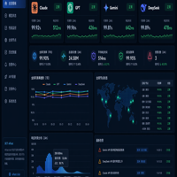

<div align="center">
  
  <h1>AIFast | One API for global and Chinese AI models</h1>
  <p><strong>99% model availability · 500+ models · fast and stable · direct mainland China access · business invoices</strong></p>
  <p>
    <a href="https://www.aifast.hk/?utm_source=github&utm_medium=repository&utm_campaign=integration-guide&utm_content=api-status-hero-website-en"></a>
    <a href="https://www.aifast.hk/pricing?utm_source=github&utm_medium=repository&utm_campaign=integration-guide&utm_content=api-status-hero-pricing-en"></a>
    <a href="https://docs.aifast.hk/en/payment/?utm_source=github&utm_medium=repository&utm_campaign=international-payment&utm_content=api-status-hero-payment-en"></a>
  </p>
  <p><a href="README.md">中文</a> · <a href="https://api.aifast.hk/">API docs</a> · <a href="https://docs.aifast.hk/en/start/?utm_source=github&utm_medium=repository&utm_campaign=developer_acquisition&utm_content=api-status-hero-start-en">Start by task</a> · <a href="https://docs.aifast.hk/en/model-check/">Online model check</a> · <a href="https://docs.aifast.hk/en/tools/codex/?utm_source=github&utm_medium=repository&utm_campaign=integration-guide&utm_content=api-status-hero-codex-en">Codex API setup</a></p>
</div>

> **Site note:** `www.aifast.hk` is the current official site and the only primary promotion entry. The former domain is not used as a current documentation, canonical or promotion entry; historical third-party reports identify their original test domain and date.

---

## One API for multi-model applications

[AIFast](https://www.aifast.hk/?utm_source=github&utm_medium=repository&utm_campaign=integration-guide&utm_content=api-status-intro-en) provides an OpenAI-compatible AI API gateway for developers, studios and enterprise teams. Existing OpenAI SDK applications can usually migrate by replacing the Base URL, API key and model ID.

| Service highlight | What it provides |
|:---|:---|
| **99% model availability** | Stable calls for development, production applications and automation |
| **500+ models** | Language, image, video, embedding and retrieval models in one account |
| **Fast and stable** | Less provider-specific integration and maintenance |
| **Direct mainland China access** | Access international models without configuring a separate proxy |
| **Business invoices** | Invoice support for enterprise procurement in China |

## Supported models and tools

- OpenAI, Claude, Gemini, Grok, DeepSeek, Qwen, GLM, Kimi and Doubao;
- language, image generation, video generation, embedding, reranking and retrieval;
- Cursor, Claude Code, Codex, OpenClaw, Hermes, Dify, Cherry Studio, Chatbox, OpenWebUI and n8n.
- Codex custom-provider setup: [configuration](https://docs.aifast.hk/en/tools/codex/?utm_source=github&utm_medium=repository&utm_campaign=integration-guide&utm_content=api-status-codex-setup-en) and [Responses, tool-call, compaction and thread-resume validation](https://docs.aifast.hk/en/troubleshooting/codex-gateway-checklist/?utm_source=github&utm_medium=repository&utm_campaign=integration-guide&utm_content=api-status-codex-troubleshooting-en).

Check the current [models and pricing](https://www.aifast.hk/pricing?utm_source=github&utm_medium=repository&utm_campaign=integration-guide&utm_content=api-status-models-en) page for exact model IDs and account pricing.

## Gemini 4 Argon catalog evidence (reviewed 2026-10-15)

AIFast announced `gemini-4-argon` on 2026-10-14 at https://www.aifast.hk/api/status. Its public catalog at https://www.aifast.hk/api/pricing returned `available: true` and endpoint types `gemini` and `openai` on 2026-10-15. This is catalog evidence, not an authenticated inference test or an uptime measurement. Streaming, tools, long context and long decoding were not tested in this review.

Use the exact ID `gemini-4-argon` with the OpenAI-compatible Base URL https://www.aifast.hk/v1 for an initial short-text test. Check current pricing and account groups at https://www.aifast.hk/pricing. For protocol checks, use https://docs.aifast.hk/model-check/ with a temporary limited key; requests may incur charges.

Source excerpt: https://kkwang4444.github.io/api-status/data/gemini-4-argon.json

## Start in three steps

1. Review [payment and account setup](https://docs.aifast.hk/en/payment/?utm_source=github&utm_medium=repository&utm_campaign=international-payment&utm_content=api-status-steps-payment-en).
2. Create an API key in the console and copy a model ID.
3. Change the Base URL in your application to `https://www.aifast.hk/v1`.

```python
import os
from openai import OpenAI

client = OpenAI(
    base_url="https://www.aifast.hk/v1",
    api_key=os.environ["AIFAST_API_KEY"],
)

response = client.chat.completions.create(
    model="your-model-id",
    messages=[{"role": "user", "content": "Hello"}],
)

print(response.choices[0].message.content)
```

See the [API documentation](https://api.aifast.hk/) and [developer documentation](https://docs.aifast.hk/en/) for streaming, tool calling and troubleshooting examples.

## Check an existing model gateway

The free [online model check](https://docs.aifast.hk/en/model-check/?utm_source=github&utm_medium=repository&utm_campaign=model-check&utm_content=api-status-check-en) inspects OpenAI-compatible HTTPS endpoints and reports protocol metadata, token fields, randomized prompts, SSE streaming and tool calling behavior. It also supports third-party gateways; use a temporary low-limit API key when testing.
## Payment and account settlement

The new site funds accounts in USD and credits balances 1:1: **⭐️ 1 AIFast Credit = US$1**. Supported methods, discounts, network instructions and final charges are shown in the console and checkout page. ⭐️ is a platform usage-unit label, not a separate currency or cryptocurrency token.

## Main links

| Next step | Link |
|:---|:---|
| View models and pricing | [Models and pricing](https://www.aifast.hk/pricing?utm_source=github&utm_medium=repository&utm_campaign=integration-guide&utm_content=api-status-bottom-pricing-en) |
| Payment and account setup | [Review options](https://docs.aifast.hk/en/payment/?utm_source=github&utm_medium=repository&utm_campaign=international-payment&utm_content=api-status-bottom-payment-en) |
| Read API parameters | [API docs](https://api.aifast.hk/) |
| Choose a first-call, migration or enterprise workflow | [Start by task](https://docs.aifast.hk/en/start/?utm_source=github&utm_medium=repository&utm_campaign=developer_acquisition&utm_content=api-status-bottom-start-en) |
| Read integration guides | [Developer center](https://docs.aifast.hk/en/) |
| Configure and validate a Codex custom provider | [Codex API guide](https://docs.aifast.hk/en/tools/codex/?utm_source=github&utm_medium=repository&utm_campaign=integration-guide&utm_content=api-status-bottom-codex-en) |
| Test an existing endpoint | [Online model check](https://docs.aifast.hk/en/model-check/) |

---

<div align="center">
  <strong>AIFast: 99% model availability · 500+ models · fast and stable · direct mainland China access · business invoices</strong><br><br>
  <a href="https://www.aifast.hk/?utm_source=github&utm_medium=repository&utm_campaign=integration-guide&utm_content=api-status-footer-en">www.aifast.hk</a>
</div>
